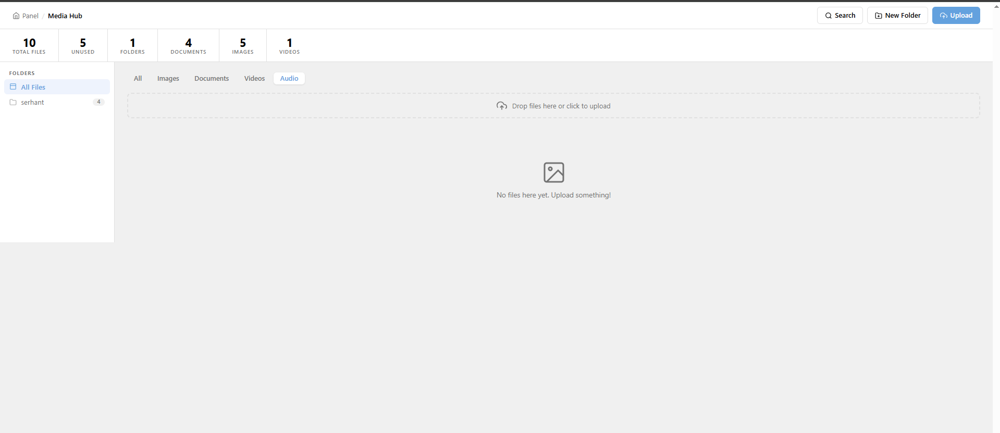

# Kirby Media Hub Pro

A centralized media library plugin for [Kirby CMS](https://getkirby.com) 5 — WordPress-style asset management built directly into the Panel.



---

## Versions

| Version | Price | Key additions |
|---------|-------|---------------|
| **V1 — Pro** | Free | Folders, search, metadata, picker field, usage tracking, stats, focus points (Panel + automatic on the frontend) |
| **V2 — Pro Smart** | €40 | + 2-level subfolders, tags, smart filters, bulk operations, duplicate detection, auto WebP conversion, image compression, upload progress indicator, single-file rename, folder rename |

---

## Features

### V1 — Core
- **Dedicated Panel area** — full-screen Media Hub accessible from the Kirby sidebar
- **Folder organisation** — create and delete folders to keep assets tidy
- **Drag-and-drop upload** — upload files directly to any folder
- **Full-text search** — searches filename, title, alt text, description, copyright, and photographer simultaneously
- **File metadata** — edit title, alt text, description, copyright, photographer, and upload date per file
- **`mediahubpicker` field** — custom field type for any blueprint; opens the library in a modal (works inside block and structure drawers)
- **Edit metadata from the page** — click a file in the picker (or ✎ on a selected file) to edit title, alt text, description and tags without leaving the page; images without alt text are flagged with an ALT badge. Any user whose Kirby role may update files can save metadata
- **Replace file** — upload a new version from the detail panel or the picker; UUID, metadata and folder are kept, so every page using the file updates (JPG/PNG onto WebP is converted automatically)
- **Rename file** — rename a single file straight from the detail panel; the extension and the UUID are kept, so every page using the file keeps working. Restricted to the roles in `kirbycode.media-hub.rename-roles` (Pro)
- **Focus point** — click an image in the detail panel or the picker's details pane to set its focus point; **Reset** goes back to the point it was opened with, **Remove** clears it. Saved to Kirby's native `focus` field, so `$file->crop()` and Kirby's own file view use the same point. On the frontend it is applied to every `` automatically, with no template changes. See [Focus Points](#focus-points)
- **Upload from the picker** — drag files onto the picker modal or click **Upload**; they go into the folder selected in the sidebar (or the Media Hub root), are selected automatically and open in the details pane for alt text. Uses Kirby's own upload API, so role permissions, the upload whitelist and WebP optimization all apply. The field's `accept` option is respected
- **UUID-based references** — saved as `file://uuid` — identical format to Kirby's native `files` field
- **Usage tracking** — see every page that references a given file
- **Dashboard stats** — total files, unused files, type breakdown, recent uploads, largest files
- **Auto-refresh stats** — counters update immediately after upload or delete
- **No build step** — pure PHP + Vue 3 template strings

### V2 — Pro Smart
- **2-level subfolder support** — nested folders in the sidebar with expand/collapse, breadcrumbs, correct upload URLs
- **Rename folder** — hover a folder or subfolder in the sidebar and click the pencil; **Enter** saves, **Esc** cancels. Name and URL slug both change, subfolders and files move along, and file UUIDs are kept, so every page using those files keeps working. Restricted by `kirbycode.media-hub.rename-roles`, like file rename. See [Renaming a folder](#renaming-a-folder)
- **Tags & Keywords** — tag files with comma-separated keywords; tag cloud in sidebar with click-to-filter
- **Delete tag globally** — remove a tag from all files at once with a single click (hover × on any tag)
- **Smart Filtering** — filter by upload date range, uploaded-by user, and file size (min/max KB)
- **Bulk Operations** — select multiple files → bulk delete, bulk move to folder, bulk rename (pattern `file-{n}`), bulk tag assignment (add / remove / replace)
- **Duplicate Detection** — scan for exact duplicates (MD5 hash) and similar-named files; keep oldest, newest, or shortest name with one click
- **Improved picker** — sidebar layout with scrollable folder tree (subfolders collapsible) + tag filter; replaces flat tab row that broke at scale
- **Auto WebP conversion on upload** — JPEG and PNG files are automatically converted to WebP on upload using PHP GD; original file and sidecar are replaced, UUID is preserved so all existing page references continue to work
- **In-place WebP compression** — existing WebP files are re-encoded at optimised quality; file is only replaced if the result is strictly smaller
- **Re-optimize button** — manually trigger optimization on any image from the file detail panel
- **Upload progress indicator** — animated progress bar and spinner shown in the drop zone while upload and optimization run; shows "Uploading & optimizing X of Y…"

---

## Requirements

- Kirby CMS **5.0** or higher
- PHP **8.1** or higher
- PHP **GD extension** — required for V3 auto WebP conversion and compression (usually bundled with PHP; check with `php -m | grep gd`)

---

## Installation

### Via Composer (recommended)

```bash
composer require kirbycode/media-hub-pro
```

### Manual

1. Purchase a license at [kirbycode.com](https://kirbycode.com)
2. Download the plugin zip from your account
3. Extract and copy the `media-hub-pro` folder into your site's `site/plugins/` directory

The plugin auto-creates `content/media-hub/` on the first page load — no further setup needed.

---

## Configuration

All options go in your site's `config/config.php`:

```php
return [
    // Your Media Hub Pro license key (required for V2 Pro Smart features).
    // Purchase a license at kirbycode.com — omit this key to run in Free (V1) mode.
    'kirbycode.media-hub.license' => 'MHPRO-XXXX-XXXX-XXXX-XXXX',

    // Change the slug of the hub root page (default: 'media-hub').
    // Useful if your site already has a page at that slug.
    'kirbycode.media-hub.root-slug' => 'media-hub',

    // V3 — Media Optimization (all keys optional; shown values are defaults)
    'kirbycode.media-hub.optimization' => [
        'enabled' => true,           // set to false to disable auto-conversion on upload
        'quality' => [
            'webp' => 82,            // WebP output quality (0–100)
        ],
    ],

    // Apply focus points to every  on the frontend (Free and Pro).
    // Set to false to handle them in your own templates instead.
    'kirbycode.media-hub.focus-frontend' => true,
];
```

### Media Optimization notes (V3)

- JPEG and PNG uploads are automatically converted to **WebP** server-side on upload. The original file is deleted; the new `.webp` file carries the same UUID so all `file://` references in content continue to resolve without any manual edits.
- **PNG transparency** is preserved during conversion.
- **SVG and GIF** files are never converted.
- If PHP GD is not available the upload still succeeds — no error is thrown; optimization is silently skipped.
- The **Re-optimize** button in the file detail panel triggers the same conversion on demand. For files already in WebP format it attempts in-place compression and reports how many bytes were saved.

---

## Blueprint Usage

Add the `mediahubpicker` field type to any page or file blueprint:

### Single image picker

```yaml
fields:
  hero_image:
    label: Hero Image
    type: mediahubpicker
    multiple: false
    accept: image
```

### Multi-select gallery

```yaml
fields:
  gallery:
    label: Gallery
    type: mediahubpicker
    multiple: true
    accept: image
    help: Pick images from the Media Hub
```

### Document / PDF picker

```yaml
fields:
  brochure:
    label: Download
    type: mediahubpicker
    multiple: false
    accept: document
```

### Field options

| Option | Type | Default | Description |
|--------|------|---------|-------------|
| `multiple` | bool | `true` | Allow selecting more than one file |
| `accept` | string | *(all)* | Filter picker to a type: `image`, `document`, `video`, `audio` |
| `label` | string | `Media Hub Files` | Panel field label |
| `help` | string | — | Help text shown below the field |

### What gets saved

The field writes a standard Kirby YAML list of `file://` UUIDs to the content `.txt` file — the same format as Kirby's built-in `files` field:

```
Hero_image:

- file://abc123def456
```

---

## PHP Template Usage

### Single file

```php
$hero = $kirby->file($page->hero_image()->value());
if ($hero) {
    echo 'url() . '" alt="' . $hero->content()->alt() . '">';
}
```

### Multiple files / gallery

```php
foreach ($page->gallery()->yaml() as $ref) {
    $file = $kirby->file($ref);
    if ($file) {
        echo 'url() . '" alt="' . $file->content()->alt() . '">';
    }
}
```

---

## Focus Points

A focus point marks the part of an image that must stay visible when the image is cropped, such as a face in a wide hero image. It's stored in Kirby's own `focus` field (`62.5% 30.1%`). So `$file->crop()`, Kirby's file view and the Media Hub all use the same point.

### Setting a focus point in the Panel

Open an image in the Media Hub detail panel, or in the picker's details pane. Then:

| Action | What it does |
|--------|--------------|
| **Click the image** | Sets the focus point where you click. A marker shows it, and it's saved right away. |
| **Click again** | Moves the focus point. |
| **Reset** | Puts the focus point back to what it was when you opened the image, or removes it if the image had none. Shown only after you've changed the point. |
| **Remove** | Clears the focus point. The image falls back to the centre (`50% 50%`). |

The text under the image shows the current value, e.g. *Focus: 62.5% 30.1%*. Grid and picker thumbnails follow the point too.

Any user whose Kirby role may update the file can set it (Free and Pro). SVGs don't get a focus point, because Kirby can't crop them.

### On the frontend

**Automatic (default, Free and Pro):** after Kirby renders a page, the Media Hub adds `object-position: X% Y%` to every `` whose `src` (or `data-src`) is an image with a focus point. It works for the original file, its thumbs and `srcset` sizes, whichever template, snippet or block wrote the tag. With `object-fit: cover`, the browser then crops around the focus point. You don't need to change your templates.

- Images without a focus point are left alone, so your stylesheet's `object-position` stays the default.
- An `` that already has an inline `object-position` keeps it, so you can override single images.
- Existing inline styles are kept, and the focus point is appended.
- It runs before Kirby's page cache, so cached pages are rewritten once, not on every visit.
- It doesn't reach CSS `background-image`s or images added by JavaScript after the page loads. Use `$file->focusPosition()` for those (see below).

Turn it off with `'kirbycode.media-hub.focus-frontend' => false` if you'd rather control it in templates with the options below.

For sites without the Media Hub, the same feature is available as the [Media Focus Point](https://github.com/logitechshiv/media-focus-point) add-on.

**In templates**, how a focus point reaches visitors depends on who crops the image:

**1. The server crops** (`crop()`, or thumbs/srcsets with `'crop' => true`): nothing to do. Kirby uses the focus point automatically, and changing it produces new thumbs (the position is part of the thumb filename).

```php
echo $hero->crop(800, 450)->html();

// config.php: a srcset preset that crops around the focus point
'thumbs' => ['srcsets' => ['card' => [
    '400w' => ['width' => 400, 'height' => 300, 'crop' => true],
    '800w' => ['width' => 800, 'height' => 600, 'crop' => true],
]]],
```

**2. The browser crops** (width-only thumbs plus CSS `object-fit: cover`, the common case): the browser keeps the centre unless the `` gets `object-position`. Use the file methods the plugin adds:

```php
thumb(['width' => 1200])->url() ?>"
     style="<?= $hero->focusStyle() ?>"
     class="object-cover w-full h-full">
```

| Method | Returns |
|---|---|
| `$file->focusPosition()` | `"62.5% 30.1%"`, or `null` without a focus point |
| `$file->focusStyle()` | `"object-position: 62.5% 30.1%"`, or `''` |

Images without `object-fit: cover`, or without a focus point, render exactly as before, so adding `focusStyle()` to a site's image snippet is safe everywhere.

**3. Ready-made snippet**: responsive `` with srcset, alt, lazy loading and the focus point:

```php
<?php snippet('media-hub/image', [
    'file'  => $hero,
    'class' => 'object-cover w-full h-full',
    'sizes' => '(min-width: 1024px) 50vw, 100vw',
]) ?>

<?php // server-side crop instead (1x + 2x), also around the focus point ?>
<?php snippet('media-hub/image', ['file' => $hero, 'crop' => [400, 300], 'format' => 'webp']) ?>
```

Options: `file`, `class`, `alt` (default: alt field, then filename), `sizes` (default `100vw`), `srcset` (preset name from `thumbs.srcsets` or an array; default `default`, falling back to 400–1800w), `fallbackWidth` (1600), `format`, `quality`, `crop` (`[width, height]`), `loading` (`lazy`), `fetchpriority`, `width`, `height`, `style` (merged with the focus style), `attrs` (any other attributes). SVG and GIF are output as the original file.

---

## Folders

Folders appear in the Media Hub sidebar. Each one is a Kirby page with the `media-hub-folder` template under `content/media-hub/`.

| Action | How | Plan |
|--------|-----|------|
| **Create a folder** | **New Folder** in the toolbar | Free |
| **Create a subfolder** | Open a folder, then **New Folder**; one subfolder level is supported | Pro |
| **Rename** | Hover a folder or subfolder and click the pencil. Type the new name; **Enter** saves, **Esc** or clicking away cancels | Pro |
| **Delete** | Hover a folder and click **×**. This deletes the folder, its subfolders and all their files | Admins |

### Renaming a folder

Renaming changes both the folder's **name** and its **URL slug**. The slug follows the name the same way as for a new folder: *Fotos Sommer* becomes `fotos-sommer`. Subfolders and files move with the folder, keeping their order number on disk (`1_photos` → `1_fotos-sommer`).

- **References keep working.** Pages store Media Hub files as `file://` UUIDs, which don't change, so every image and download on the site still resolves. Kirby rebuilds its UUID cache for the folder and everything in it.
- **File IDs and URLs change.** A file's ID and media URL contain the folder path (`media-hub/photos/a.jpg` → `media-hub/fotos-sommer/a.jpg`). Anything that points at a file by **path** instead of UUID will break, such as a KirbyText tag `(image: media-hub/photos/a.jpg)` or a hard-coded media URL. Use UUIDs for those.
- **Name only:** if the new name gives the same slug (e.g. *photos* → *Photos*), only the title changes.
- **Taken names are refused.** If a sibling folder already uses the new slug, the rename is refused with a message, and nothing changes.
- **The Panel follows the rename.** If the folder, or one inside it, is open, the view and the address bar switch to the new path.

**Who can rename:** users whose role has Kirby's `changeTitle` and `changeSlug` page permissions. The option `kirbycode.media-hub.rename-roles` narrows that to named roles, and it applies to renaming files and folders alike:

```php
// site/config/config.php
'kirbycode.media-hub.rename-roles' => ['admin', 'manager'],
```

Unset (the default), Kirby's own permissions alone decide. The rename runs as the current user, so Kirby re-checks its rules.

API: `PATCH /api/media-hub/folders/<path>` with `{ "title": "New name" }`. In `<path>`, a subfolder's `/` is written as `+` (`photos+2024`). The response contains `oldPath`, `path`, `slug` and `title`.

---

## Bulk Operations (V2)

Enable **Select mode** in the toolbar to check multiple files, then choose an action:

| Action | What it does |
|--------|--------------|
| **Bulk Delete** | Permanently deletes all selected files |
| **Bulk Move** | Moves all selected files to a chosen folder |
| **Bulk Rename** | Renames using a pattern, e.g. `photo-{n}` → `photo-1.jpg`, `photo-2.jpg` |
| **Bulk Tag** | Add / Remove / Replace tags on all selected files at once |

Every action also checks the user's Kirby permissions per file (role + blueprint options): e.g. a role with `files.delete: false` cannot delete or move files, and those files are listed as errors instead of being changed.

---

## Duplicate Detection (V2)

Open **Duplicates** from the toolbar to scan the library:

- **Exact duplicates** — files with identical MD5 hash
- **Similar names** — files with matching base names after stripping suffixes like `-final`, `-copy`, `-v2`, `(1)`, etc.

For each group you can: keep the oldest, keep the newest, keep the shortest filename, or manually pick which copy to keep.

---

## Supported File Types

| Category | Extensions |
|----------|-----------|
| Images | jpg, jpeg, png, gif, webp, svg, avif |
| Documents | pdf, doc, docx, xls, xlsx, ppt, pptx, odt, ods, odp, txt, csv |
| Video | mp4, mov, m4v, webm, avi |
| Audio | mp3, wav, ogg, m4a |
| Archives | zip, gz, tar |
| Design | ai, eps, psd |

Uploads with any other extension are rejected (scripts and markup such as `.js`, `.xml` or `.html` can never be uploaded). To change the list, set `kirbycode.media-hub.accept` — it replaces the file blueprint's [`accept`](https://getkirby.com/docs/reference/panel/blueprints/file#accept) option:

```php
'kirbycode.media-hub.accept' => [
    'extension' => ['jpg', 'jpeg', 'png', 'webp', 'svg', 'pdf', 'mp4'],
    'maxsize'   => 10 * 1024 * 1024, // 10 MB
],
```

---

## How It Works

The plugin registers a Kirby content page at `content/media-hub/` (auto-created on first load). Subfolders are standard Kirby child pages with the `media-hub-folder` template. Files use Kirby's native flat-file storage with `.txt` metadata sidecars.

The Panel area is a custom Kirby `area` with Vue 3 components (no build step — uses Kirby's bundled runtime). REST API routes under `/api/media-hub/` handle all operations.

---

## Upgrading

### To 1.8

- **Focus points now reach the frontend automatically.** After updating, every `` of an image with a focus point gets `object-position` inline, on every page. Images without a focus point don't change. An inline `object-position` in your markup always wins.
  - **If your stylesheet sets `object-position` on such images,** the editor's focus point now overrides it. That's usually what you want. To keep handling it in templates, set `'kirbycode.media-hub.focus-frontend' => false`.
  - **If you use the [Media Focus Point](https://github.com/logitechshiv/media-focus-point) add-on,** you can remove it. If you keep it, it steps aside on its own.
- **`rename-roles` now also covers folders.** If you set `kirbycode.media-hub.rename-roles`, the same roles can now rename folders (Pro).
- **`focusPosition()` / `focusStyle()`** now also accept keywords such as `top left` and the old JSON focus format. Values that were valid before give the same result.

---

## Changelog

See [CHANGELOG.md](CHANGELOG.md).

---

## License

Proprietary — [Shivlal Sheladiya](https://kirbycode.com). All rights reserved.
A valid license is required. Purchase at [kirbycode.com](https://kirbycode.com).

---

## Credits

Built with [Kirby CMS](https://getkirby.com) by [kirbycode.com](https://kirbycode.com).

If this plugin saves you time, consider [sponsoring further development](https://kirbycode.com).
